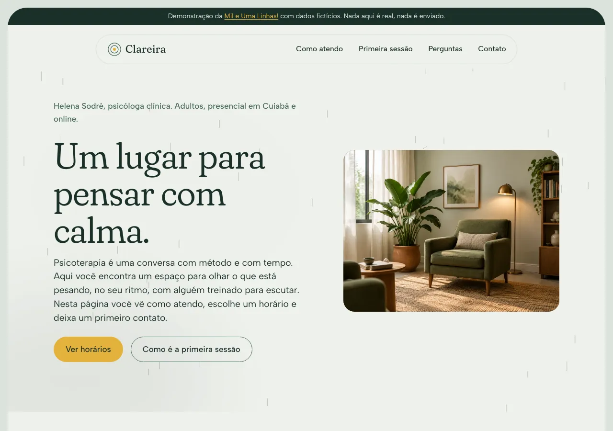
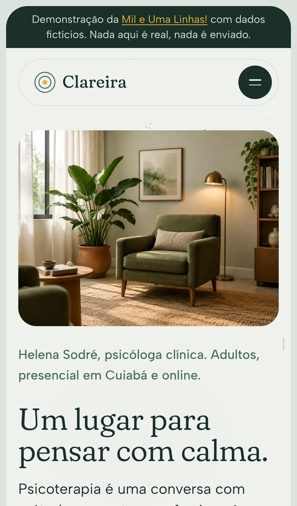
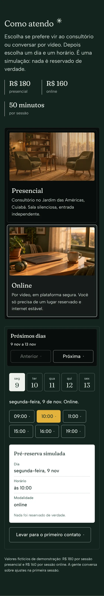
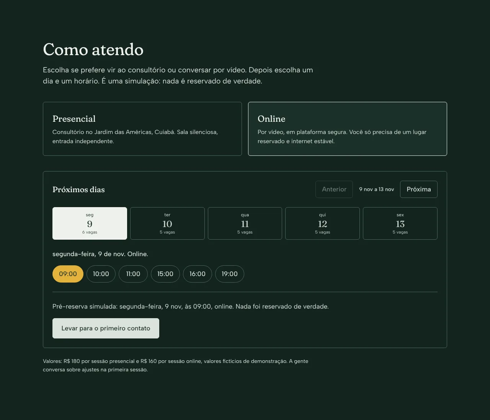
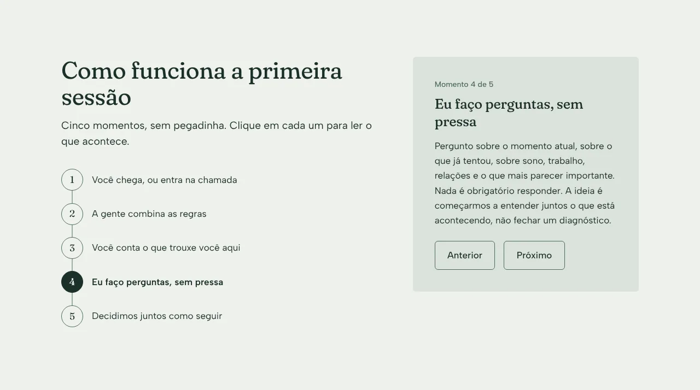
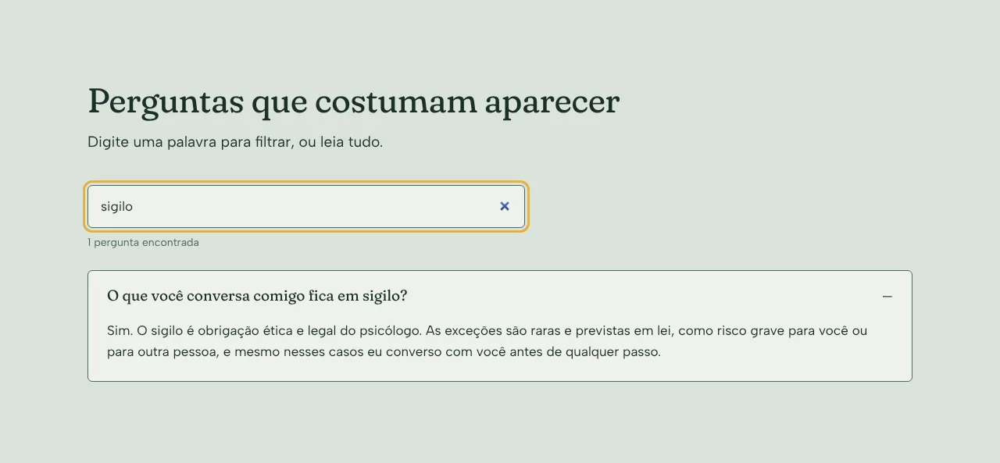
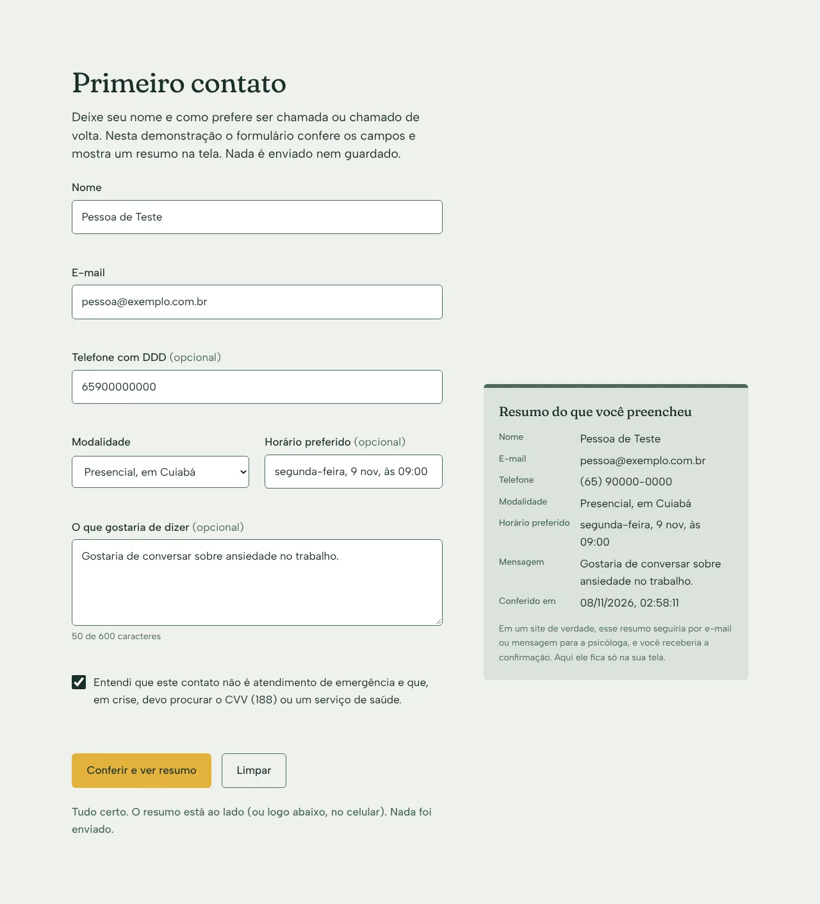

# Clareira Psicologia

Site de demonstração para um consultório de psicologia. Eu, Rodrigo Jr, da [Mil e Uma Linhas!](https://mileumalinhas.com.br), fiz este site para mostrar a psicólogas e psicólogos como pode ser a presença online deles: calma, clara, com identidade própria e com funções que realmente ajudam quem está procurando atendimento.

Endereço publicado: https://toshiro01001.github.io/psicologia/

> **Tudo aqui é fictício.** A psicóloga Helena Sodré, o CRP, o endereço, o telefone, os valores e os horários foram inventados por mim para a demonstração. Nenhum contato é enviado, nenhuma consulta é marcada, nenhum dado é guardado.

## O que o site é, para quem não é da área

É uma página única que apresenta um consultório e deixa a pessoa fazer quatro coisas sem sair dela:

1. **Escolher entre presencial e online** e ver, numa agenda simulada, os dias e horários das próximas quatro semanas.
2. **Entender a primeira sessão** em cinco momentos, clicando em cada um.
3. **Tirar dúvidas** nas perguntas frequentes, com uma busca que filtra enquanto digita.
4. **Deixar um primeiro contato** num formulário que confere os campos e mostra um resumo na tela.

Tudo isso funciona no celular, no tablet e no computador.

## Como usar, em passos

1. Abra o endereço. A faixa escura no topo lembra que é uma demonstração.
2. Em **Como atendo**, toque em "Presencial" ou "Online". Depois toque num dia e num horário. Aparece uma pré-reserva simulada e o botão "Levar para o primeiro contato", que já preenche o formulário com a modalidade e o horário.
3. Em **Como funciona a primeira sessão**, clique nos números ou use "Anterior" e "Próximo".
4. Em **Perguntas**, digite uma palavra (por exemplo "sigilo" ou "valor"). As perguntas que não combinam somem; as que combinam abrem sozinhas.
5. Em **Primeiro contato**, preencha nome, e-mail, modalidade e marque a caixa de ciência. Se faltar algo, o campo fica marcado e a mensagem explica. Se estiver tudo certo, o resumo aparece no bilhete ao lado (ou abaixo, no celular). Nada é enviado.

| Celular, abertura | Celular, agenda |
| --- | --- |
|  |  |

## Identidade visual em resumo

O estudo completo está em [`docs/identidade.md`](docs/identidade.md).

- **Nome e ideia:** Clareira, o espaço aberto no meio da mata onde a luz chega. Frase: "Um lugar para pensar com calma."
- **Paleta:** Névoa `#EEF1EC` (fundo), Pinho `#1B3029` (texto), Musgo `#4B6B5E` (apoio), Pedra `#DCE3DB` (superfícies), Noite `#14241F` (seções escuras) e Sol `#E3B23C` (destaque). O Sol aparece em um único elemento por tela: o botão principal da abertura, o horário escolhido, o botão de conferir.
- **Fontes:** Fraunces (títulos, com os eixos SOFT e WONK ligados, que dão calor e um pouco de personalidade) e Albert Sans (texto). As duas são locais, em `fonts/`, licença SIL Open Font License.
- **Imagem forte:** uma foto de um canto de consultório, com poltrona verde-musgo, planta e luz de abajur, em `img/hero.webp`, e mais seis fotos ao longo da página (lista abaixo). **Todas as fotos foram geradas por IA no Canva e são só ilustrativas**: os espaços mostrados não existem e a mulher do retrato não é uma pessoa real.
- **Visual da página:** a página inteira fica numa "concha" de papel arredondada, com o menu numa cápsula flutuante, cartões brancos de cantos bem redondos, uma chuva fina na abertura e folhas caindo no fechamento. As partes escuras (como atendo e rodapé) usam vidro escuro, números com uma linha fina ao lado e botões só de contorno. Esse visual mistura dois design systems do meu catálogo, TerraSprint e Vesper; o detalhe está no fim de [`docs/identidade.md`](docs/identidade.md).
- **Por quê:** psicologia pede calma sem frieza. Verde fechado e luz amarela remetem a natureza e acolhimento sem cair no lilás-pastel, no azul de hospital ou no bege com terracota que todo mundo usa. Sem fotos de banco de imagem (todas são geradas por IA), sem gradientes, sem sombras: a profundidade vem das cores das superfícies.

### Fotos do site

> **Aviso:** todas as fotos abaixo foram geradas por IA no Canva e são ilustrativas. Não mostram um consultório real nem uma psicóloga real.

| Arquivo | Tamanho | Onde aparece |
| --- | --- | --- |
| `img/hero.webp` | 1440 x 1080 (4:3) | Abertura, ao lado do título |
| `img/helena-retrato.webp` | 1088 x 1456 (3:4) | "Quem está do outro lado da conversa", primeira coluna |
| `img/sala-presencial.webp` | 1456 x 816 (16:9) | Opção "Presencial" em "Como atendo" |
| `img/sala-online.webp` | 1456 x 816 (16:9) | Opção "Online" em "Como atendo" |
| `img/primeira-sessao-espera.webp` | 1456 x 1088 (4:3) | Painel de "Como funciona a primeira sessão" |
| `img/perguntas-clareira.webp` | 1152 x 1440 (4:5) | Ao lado das perguntas (no celular, recortada em 4:3 acima da busca) |
| `img/contato-bilhete.webp` | 1024 x 1024 (1:1) | Bilhete do primeiro contato, enquanto ainda está vazio |

Capturas das funções no computador:

| Agenda | Primeira sessão |
| --- | --- |
|  |  |

| Perguntas com busca | Primeiro contato com resumo |
| --- | --- |
|  |  |

## Como funciona por dentro, em linguagem comum

O site são três arquivos principais que o navegador lê e monta: `index.html` (o conteúdo), `css/estilo.css` (a aparência) e `js/site.js` (o comportamento). Não existe servidor fazendo conta: a agenda é desenhada pelo próprio navegador a partir da data de hoje, com horários "sorteados" de um jeito fixo para cada dia, por isso o mesmo dia mostra sempre os mesmos horários. O formulário confere o que você digitou e copia para o bilhete ao lado. Quando você fecha ou recarrega a página, tudo some.

## Detalhes técnicos

- HTML, CSS e JavaScript puros. Sem framework, sem biblioteca, sem CDN, sem analytics, sem fontes externas.
- `Content-Security-Policy` por `meta`: `default-src 'self'`, sem script inline, sem estilo inline, `connect-src 'none'`, `form-action 'none'`.
- Fontes variáveis locais: `fonts/fraunces-latin-full-normal.woff2` (121 KB) e `fonts/albert-sans-latin-wght-{normal,italic}.woff2` (32 e 34 KB), obtidas dos pacotes `@fontsource-variable/fraunces` e `@fontsource-variable/albert-sans`.
- Agenda: dias úteis da semana atual mais três (botões "Anterior" e "Próxima"); dias passados ficam desligados; horários de hoje que já passaram somem; online acrescenta 18h e 19h. Função determinística baseada no número do dia.
- Primeira sessão: cinco passos em um array; botões com `aria-current="step"`; painel com `aria-live`.
- Busca das perguntas: normaliza acentos (`NFD`), filtra por `includes`, abre os `
` que combinam, mostra contagem em `aria-live` e aviso quando nada combina.
- Formulário: `novalidate`, validação própria (nome com sobrenome, e-mail com padrão simples, telefone com 10 ou 11 dígitos quando preenchido, modalidade e caixa de ciência obrigatórias), erros ligados por `aria-describedby` e `aria-invalid`, resumo montado com `textContent`.
- Fotos: cada uma num contêiner com a proporção dela (`aspect-ratio`), `object-fit: cover` e a cor média da foto como fundo enquanto carrega; `width` e `height` reais no HTML para a página não pular; só a da abertura carrega de imediato, as outras com `loading="lazy"` e `decoding="async"`.
- Movimento: chuva da abertura e folhas do fechamento em `canvas` 2D próprio (no máximo 2x de densidade), que só rodam enquanto a parte está na tela e param quando a aba fica oculta; revelação por `IntersectionObserver` (12%); o brilho verde que segue o ponteiro é desenhado uma vez numa imagem fora da tela e só copiado para o canvas da chuva a cada quadro, que é bem mais leve do que um desfoque em CSS se mexendo. Tudo desligado com `prefers-reduced-motion` (aí fica só um brilho parado em CSS).
- Acessibilidade: contraste AA em todos os pares (mínimo 4,5:1), foco visível em Sol, navegação por teclado em todos os controles (o menu do celular fecha com Esc), botões e links com pelo menos 44px de altura no toque, `lang="pt-BR"`, `prefers-reduced-motion` respeitado.
- Arquivos de publicação: `404.html` com caminhos absolutos `/psicologia/...`, `robots.txt`, `sitemap.xml`, `google20db0e080e71c701.html`, `favicon.svg` e as fotos em `img/`.

## Como rodar no seu computador

1. Baixe os arquivos (ou clone o repositório).
2. Na pasta do site, rode `python3 -m http.server 8305`.
3. Abra `http://localhost:8305/` no navegador.

Qualquer servidor de arquivos estáticos serve. Abrir o `index.html` direto do disco também funciona, mas as fontes podem não carregar em alguns navegadores por causa da CSP.

## Testes

`tests/site.cjs` usa Playwright (precisa de `npm i -D playwright` e do Chromium dele). Rode `node tests/site.cjs` a partir da pasta do site: ele sobe o servidor sozinho na porta 8305, abre a página em 1280x900, iPhone 13 e 320px e verifica:

- erros de console, erros de página e requisições que falharam;
- se as sete fotos carregam no tamanho real declarado e têm texto alternativo;
- rolagem horizontal e textos cortados;
- menu do celular abrindo e fechando;
- as quatro funções: agenda (modalidade, dia, horário, levar para o contato), passos, busca e formulário (erros e resumo);
- a página 404.

As capturas ficam em `tests/saida/` (fora do repositório). Com a variável `SHOTS_DIR=/pasta`, salva também a abertura em 1440x900 e no celular.

## Segurança

Vistoria completa em [`docs/vistoria.md`](docs/vistoria.md), atualizada em 08/11/2026 com a leva final. Em resumo: nenhum dado sai do navegador, nada é guardado (`localStorage`, cookies ou similares não são usados), nenhuma dependência externa, CSP restritiva, conteúdo do visitante só por `textContent`.

## Sobre a Mil e Uma Linhas!

Eu faço sites e sistemas para empresas e profissionais, em Cuiabá e online. Este é um dos sites de demonstração da série por profissão. Se você é psicóloga ou psicólogo e quer um site assim, com o seu nome e a sua cara, fale comigo em https://mileumalinhas.com.br.
